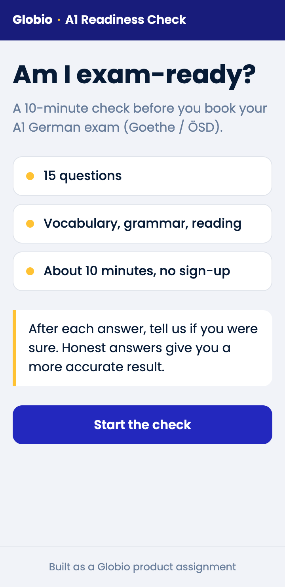
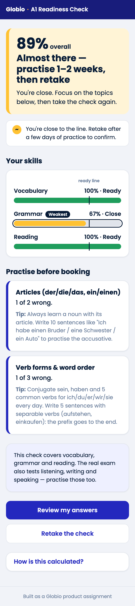
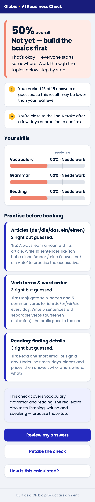

# Am I exam-ready? – A1 German readiness check

A 15-question, 10-minute check that tells A1 German learners how ready they are for the Goethe / ÖSD exam, skill by skill, and the 2–3 topics to practise before booking.

**Live demo:** _coming soon_ <!-- TODO: add deployed link -->

## Screenshots

360px (phone) unless noted.

| Landing | Reading question | Ready | Almost | Not yet |
|---|---|---|---|---|
|  |  |  |  |  |

More: [review screen](screenshots/06-review.png) · [Almost result at 1280px](screenshots/07-results-almost-desktop.png) · ["How is this calculated?" open](screenshots/08-results-explainer-open.png)

## The problem

Learners finishing an A1 course don't know whether to book the exam now or practise more. Booking too early costs an exam fee and confidence. A general "you scored 11/15" doesn't help either: it hides a weak skill and doesn't say what to do next.

This check gives a clear verdict (**likely ready**, **almost**, **not yet**), a score per skill, and 2–3 concrete topics with a practice tip each.

## How "ready" is calculated

1. **Points per question:** correct + "I'm sure" = 1, correct + "I'm guessing" = 0.5, wrong = 0. Medium questions count 1.5×.
2. **Skill score** = points earned ÷ points possible, for vocabulary, grammar and reading separately. **Overall** = the average of the three.
3. **Verdict:**
   - **Likely ready:** every skill ≥ 70% **and** overall ≥ 75%.
   - **Almost:** every skill ≥ 55% **and** overall ≥ 60%.
   - **Not yet:** anything below that.

All thresholds are named constants at the top of [`src/lib/scoring.js`](src/lib/scoring.js). The results page's "How is this calculated?" section reads them from there, so the explanation can't drift from the code.

## Key product decisions

- **Confidence tap after every answer ("I'm sure" / "I'm guessing").** A multiple-choice score mixes knowledge with luck. Correct guesses earn half a point. A wrong answer marked "sure" is flagged as a misconception and ranked first in the topics to practise, because confident mistakes are the hardest to unlearn.
- **Weakest-skill gate.** "Ready" needs *every* skill above the line, not just a high average. 100% vocabulary + 100% reading + 40% grammar averages 80%, but it is still "not yet". The real exam scores every section, so a weak skill shows up on exam day.
- **Lean strict.** The "ready" bar (70% per skill / 75% overall) is deliberately above the ~60% pass mark. A false "ready" costs the learner an exam fee; a false "almost" costs a week of practice. The wording is always "likely ready", never "you will pass".
- **Actionable output.** Topic cards are ranked by misconceptions, then share of points lost, then skill order (grammar → reading → vocabulary), then topic id, so the same answers always give the same advice. A perfect score still gets 2 "polish" topics.

## Edge cases handled

- **Rushed:** finishing in under 2 minutes shows a warning that the result may not be reliable.
- **Mostly guessing:** if more than half of the answers are marked "guessing", the page says so: "You marked 9 of 15 answers as guesses…".
- **Borderline:** any skill or the overall score within 5 points of a threshold shows "You're close to the line. Retake after a few days of practice to confirm."
- **Refresh / closed tab:** progress is saved in `localStorage` after every change. An unfinished check offers "Continue where you left off"; results survive a refresh.
- **Private mode / blocked storage:** every storage call is wrapped in `try/catch`; the check still works, it just doesn't remember.
- **Double taps:** a second tap while moving to the next question is ignored.
- **Going back:** "Back" shows the previous question with its earlier answer selected; it can be changed.
- **Unanswered questions** count as wrong, not as misconceptions.
- **Rounding:** thresholds compare raw percentages; rounding happens only on screen, so 69.6% never passes a 70% line.
- **Accessibility:** focus moves to each new question; "Question X of 15" is announced (`aria-live`); selected options use `aria-pressed`; skill bars have text labels ("67% · Close"), not colour alone; banner text contrast is 15:1; all tap targets are ≥ 48px; keyboard shortcuts 1–4, S, G.

## What it doesn't cover, and v2 ideas

**Not covered:** listening, writing and speaking — three of the four exam parts. The results page says so. 15 questions is also a small sample, which is why borderline results suggest a retake.

**v2 ideas:**
- Listening questions with short audio clips.
- A larger question bank with random draws, so retakes aren't the same 15 questions.
- Links from each topic card to the matching Globio lesson.
- Track results over time ("you've improved 12 points in grammar").
- Calibrate the thresholds against real exam outcomes from Globio learners.
- An A2 version.

## Tech stack

- React 19 + Vite, plain JavaScript (no TypeScript)
- Plain CSS with CSS variables (colours and font matched to globio.ai; Poppins from Google Fonts), no UI library
- No backend, no login; `localStorage` for progress
- Tests: Node's built-in test runner (`node --test`), no extra dependencies

## Run locally

Requires Node 20+.

```bash
npm install
npm run dev        # start the app at http://localhost:5173
npm test           # run the scoring tests
npm run validate   # check src/data/questions.json is well-formed
npm run build      # production build into dist/
```

## Project structure

```
src/
  App.jsx                  # screen state (landing / quiz / results / review), saving & restoring
  main.jsx                 # React entry point
  index.css                # all styles; Globio colours/fonts as CSS variables
  components/
    Landing.jsx            # intro, start / continue
    Quiz.jsx               # one question per screen, confidence tap, keyboard shortcuts
    Results.jsx            # verdict, warnings, skill bars, topic cards, explainer
    Review.jsx             # every question with your answer, the correct one, explanation
  data/
    questions.json         # topics (label + tip), reading passages, 15 questions
  lib/
    scoring.js             # all scoring rules as pure functions + threshold constants
    scoring.test.js        # tests for the scoring rules
    validateQuestions.js   # sanity check for the question bank
    storage.js             # localStorage load/save with try/catch
screenshots/               # images used in this README
CLAUDE.md                  # project brief
```
