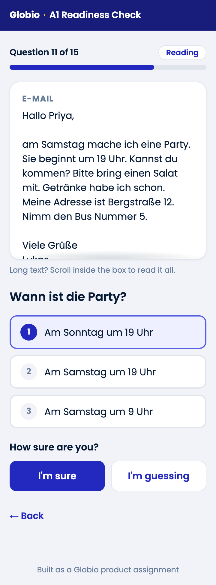
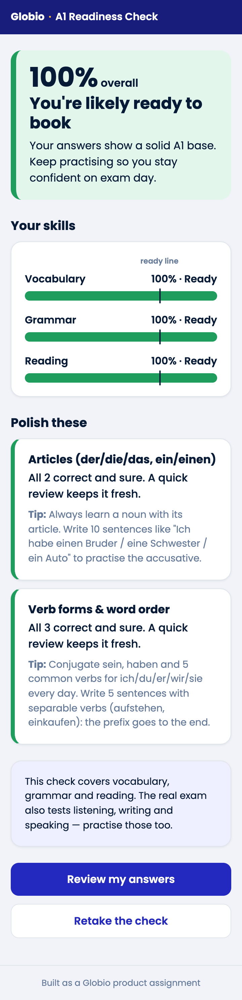

# Am I exam-ready? – A1 German readiness check

A 15-question check that tells A1 German learners how ready they are for the Goethe/ÖSD exam, per skill.

## Run locally

```bash
npm install
npm run dev
```

See `CLAUDE.md` for the full project brief.

## Screenshots

360px (phone) unless noted.

| Landing | Reading question | Ready | Almost | Not yet |
|---|---|---|---|---|
|  |  |  |  |  |

More: [review screen](screenshots/06-review.png) · [Almost result at 1280px](screenshots/07-results-almost-desktop.png)
